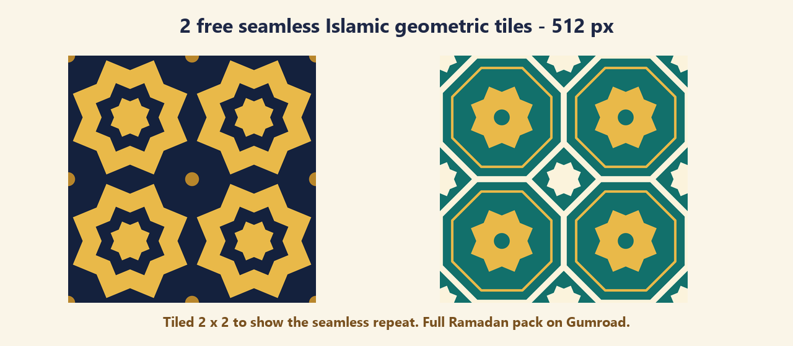

# Free Islamic Seamless Tiles (2 PNG)

Two seamless Islamic geometric tiles, 512 x 512 px. They repeat with no visible seam,
so you can use them as backgrounds, game floors, wrapping paper or card designs.

- `tiles/tile_star_cross_navy_gold_512.png`
- `tiles/tile_octagon_teal_512.png`
- Drawn with code (Python SVG), no AI image generator

## Want the full Ramadan pack?

15 seamless tiles, lanterns, crescent moons, mosque clipart and Ramadan backgrounds:
**[Ramadan & Eid Clipart and Islamic Patterns on Gumroad](https://eldesouky4.gumroad.com/l/ramadan-eid-clipart-patterns)**

## Licence

Free for personal and commercial use. Credit is nice but not required.
You may not resell or redistribute these files as an asset pack or pattern set.
See [LICENSE.txt](LICENSE.txt).
